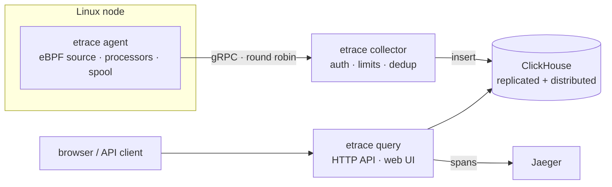

<h1 align="center">eTrace</h1>

<p align="center">
  <strong>Find what your threads wait on.</strong><br>
  Off-CPU wakeup chains, CUDA/NCCL waits, and OpenTelemetry span attribution for Linux.
</p>

<p align="center">
  <a href="https://github.com/rainyZhou2/eBPFTrace/actions/workflows/ci.yml"></a>
  <a href="LICENSE"></a>
  
  
  
  
  
  
</p>

<p align="center">
  <a href="#quick-start">Quick start</a> ·
  <a href="#how-it-works">How it works</a> ·
  <a href="#architecture">Architecture</a> ·
  <a href="#cluster-deployment">Deployment</a> ·
  <a href="docs/README.zh-CN.md">简体中文</a>
</p>

**eTrace is an eBPF profiler for wait time on Linux.** It records where threads block off-CPU, which waker ended the wait, and where CUDA threads wait on the GPU. Waits are attributed to the OpenTelemetry span that was active on the blocked thread, so a slow request or training step can be traced to the lock, I/O, or GPU kernel that held it up. It attaches to processes that are already running; the profiler itself needs no restart and no rebuild. Span attribution additionally uses the small `libetrace_ctx` SDK (see [Instrumenting applications](#instrumenting-applications)).

When a thread is woken, eTrace reconstructs the chain behind the wakeup:

```text
api  futex_wait
 └─ woken by refresher  unlock
     └─ waiting in do_nanosleep
         └─ woken by [hardirq]  hrtimer_wakeup
```

<p align="center">
  <sub><b>Status: pre-1.0.</b> Unit tests run on amd64 and arm64; the ClickHouse and e2e stacks run in CI, and the BPF kernel suite runs in QEMU on Linux 5.15 and 6.8. See <a href="#project-status-and-limitations">Project status and limitations</a> before deploying.</sub>
</p>

## Contents

- [Why eTrace](#why-etrace)
- [Quick start](#quick-start)
- [Requirements](#requirements)
- [Build](#build)
- [How it works](#how-it-works)
- [Architecture](#architecture)
- [Single-host diagnosis](#single-host-diagnosis)
- [Cluster deployment](#cluster-deployment)
- [Instrumenting applications](#instrumenting-applications)
- [Querying data](#querying-data)
- [Development](#development)
- [Project status and limitations](#project-status-and-limitations)
- [Contributing](#contributing)
- [Security](#security)
- [Acknowledgements](#acknowledgements)
- [License](#license)

## Why eTrace

- **Wakeup chains, not just stacks.** Each off-CPU wait records the waker, what the waker was waiting on, and up to four hops, built in kernel at `sched_waking`. Hard IRQ, soft IRQ, and idle wakeups become terminal hops.
- **GPU waits that never go off-CPU.** CUDA's default scheduling can spin on the CPU while a thread waits for the GPU. eTrace times the host-blocking CUDA and NCCL calls from uprobes, and records the stream and the kernel queued ahead of the wait.
- **Span attribution.** When the application publishes its current span, wait time is rolled up to that span and its ancestors. The query service joins it with Jaeger traces.
- **One host or a fleet.** `etrace doctor` writes a self-contained HTML report with no backend. The agent, collector, and query service deploy as a Kubernetes stack backed by ClickHouse.
- **Open output.** Flame graphs export as pprof and collapsed stacks; the agent can push to Grafana Pyroscope.

## Quick start

### Diagnose one host

Build the binary once (see [Build](#build)), copy `bin/etrace-linux-<arch>` to the target host, and run it as root:

```sh
sudo etrace doctor                          # all processes, 30s, writes etrace-report.html
sudo etrace doctor -pid 1234 -duration 1m
sudo etrace doctor -comm nginx -slow 50ms -o /tmp/nginx.html
```

The text summary goes to stdout and the HTML report is written to `-o`. The report contains hang candidates, wait time per process, top causes along wakeup chains, the slowest waits, and an interactive flame graph. See [Single-host diagnosis](#single-host-diagnosis) for all flags.

### Run the full stack locally

```sh
make builder   # once
make e2e
```

`make e2e` starts the agent, collector, query service, ClickHouse, Jaeger, and an instrumented Python service with Docker Compose (`test/e2e/stack`). It checks two `load_cache` traces end to end: a lock handoff driven by a readiness signal and an overlapping signal that leaves an independent unlock deadline unchanged. To keep the stack running, use `docker compose up -d --build` in `test/e2e/stack` after `make build scenarios e2e-scenario`. The web UI is at http://127.0.0.1:18080 (HTTP Basic `e2e`/`e2e`) and Jaeger is at http://127.0.0.1:16686.

The e2e stack needs a privileged Docker host with BPF access. CI runs the same stack on `ubuntu-24.04`; a runner that blocks privileged containers or BPF must run it on a self-hosted host instead.

## Requirements

### Target host

- Linux 5.8 or later with BTF (`/sys/kernel/btf/vmlinux`).
- The DWARF user-stack walker needs Linux 5.17 or later; older kernels fall back to frame pointers.
- GPU waits need Linux 5.15 or later for uprobe attach cookies; on older kernels they are not recorded.
- `CAP_BPF`, `CAP_PERFMON`, and `CAP_SYS_RESOURCE`, or root.
- glibc 2.38 or later (Debian 13, Ubuntu 24.04). libstdc++ is linked statically.

### Build host

- Docker with Buildx (Docker Desktop, or the `docker-buildx-plugin`). The builder image contains the compiler, clang for BPF, and every pinned dependency.
- gRPC 1.80 or later. The builder image pins 1.81; distribution packages such as Debian 13's 1.51 are too old for the TLS credentials code in `src/platform`.

## Build

eTrace is C++20 and builds with CMake; dependencies are pinned through vcpkg (`vcpkg.json`).

```sh
git clone https://github.com/rainyZhou2/eBPFTrace.git
cd eBPFTrace
make builder   # once: toolchain, clang for BPF, vcpkg dependencies
make build     # BPF objects + bin/etrace-linux-<arch>
make image     # runtime image (debian:trixie-slim)
make fmt       # clang-format src and test (fmt-check verifies only)
```

- The BPF programs are compiled for the build host's architecture and embedded in the binary. An amd64 binary is built on an amd64 builder; use an arm64 builder for arm64.
- The builder pulls `debian:trixie`, `deb.debian.org`, and `github.com` by default. `BASE_IMAGE`, `APT_MIRROR`, `GITHUB_PROXY`, `SOURCEWARE_MIRROR`, and `GNU_MIRROR` route the same steps through mirrors, for example `make builder BUILDER_BUILD_ARGS='--build-arg GITHUB_PROXY=https://gh-proxy.com'`. `build/vcpkg-fetch.sh` applies the last two to vcpkg downloads as well.
- Sanitizer builds are supported: `make build CMAKE_FLAGS=-DETRACE_SANITIZE=address,undefined` (or `thread`).
- `make bpf-ide-headers` and `make ide` copy the Linux/libbpf headers and the compilation database out of the builder for clangd.

## How it works

### Wakeup chains

When thread A is woken by B, eTrace checks whether B had just finished a wait of its own that overlapped A's wait. If it had, B's chain is appended to A's. The result reads, for example: `api` waited in `futex_wait` ← woken by `refresher` in `unlock`, which had been waiting in `do_nanosleep` ← woken by `[hardirq]` in `hrtimer_wakeup`.

- Hops are built in kernel at `sched_waking`, in the waker's context, so no event stream has to be joined later.
- Wakeups from hard IRQ, soft IRQ, and idle are recorded as terminal hops (`[hardirq]`, `[softirq]`, `[idle]`).
- Up to 4 hops are recorded (`chain_depth`). Each hop carries its wake stack, its own wait stack, and the part of its wait that overlapped the original wait.
- The chain is a correlation based on overlap, not a proof of causality; see [Project status and limitations](#project-status-and-limitations).

### GPU waits

With the CUDA driver's default scheduling, a thread waiting for the GPU spins on the CPU and never goes off-CPU, so scheduler events alone miss it. eTrace times the calls themselves.

- The agent finds `libcuda.so`, `libcudart.so`, and `libnccl.so` in `/proc/<pid>/maps` (`gpu.library_patterns`, rescanned every `gpu.scan_interval`) and attaches a uprobe and uretprobe pair to every exported variant (`_v2`, `_ptsz`, `_ptds`) of the calls that block the host: stream, event, and context synchronization, synchronous copies, and the frees and host allocations that synchronize.
- A wait is the time from call to return, recorded with the user stack and span at the call, when it lasts at least `gpu.min_wait`. When cudart calls into libcuda, only the outer call counts.
- If the thread sleeps inside the call (`cudaDeviceScheduleBlockingSync`), that off-CPU time is folded into the GPU wait instead of being counted twice, and the wakeup chain of the sleep is attached to it. A wakeup from the NVIDIA driver's interrupt handler shows as a `[gpu]` hop.
- Launch tracking (`gpu.launches`, on by default) probes kernel and graph launches (`cuLaunchKernel`, `cuLaunchKernelEx`, `cudaLaunchKernel`, `cudaLaunchKernelExC`, `cuGraphLaunch`, `cudaGraphLaunch`), event records, and `cuModuleGetFunction`/`cuLibraryGetKernel`. A runtime launch's internal driver call is not counted twice, including `cudaGraphLaunch` into `cuGraphLaunch`. It keeps the last kernel queued per stream and per process and maps events to the stream they were recorded on.
- Kernels launched through the runtime are named by symbolizing their host stub, which carries the kernel's (mangled) name. Kernels launched through the driver are named from the module lookup that returned their handle, so handles obtained before the agent attached show as ``[gpu kernel]`[unknown]``. Graph launches show as `CUDA graph`.
- Launch probes trap on every launch. When the host-wide launch rate exceeds `gpu.max_launch_rate` (20000/s by default), they are detached for the rest of the run; waits are still timed but name no kernel. The state is exported as `etrace_offcpu_gpu_launch_tracking`.
- The wait is named by synthetic innermost frames: `[gpu]` and the CUDA call, then ``[gpu kernel]`<name>``, then ``[gpu]`waiting on ncclAllReduce`` when the process issued an NCCL collective after its previous GPU wait and before this one, which means the thread waits for the network and the other ranks.
- These waits have reason `gpu` and appear in the same flame graphs, causes, events, and span views as off-CPU time. Events also carry `gpu_stream` and `gpu_launches`, the kernels queued on that stream since its previous wait.

### Trace correlation

Applications publish the active trace and span IDs per thread through `libetrace_ctx` (see [Instrumenting applications](#instrumenting-applications)). The library writes them to a thread-local record guarded by a sequence counter. The agent attaches a uprobe to `etrace_register_tls`, learns each thread's record address, and reads the record with `bpf_probe_read_user` when the thread blocks.

- Waits with a trace context are emitted as individual events. Waits without one are aggregated, which keeps samples small.
- The query service fetches spans from Jaeger (or another Jaeger-compatible API). It assigns each event to its span, clips the event to the span's interval, and rolls the time up to ancestor spans.

### User stacks and symbols

- User stacks are walked in BPF from the `.eh_frame` call frame information of each mapped object, so binaries built without frame pointers keep their callers. `.eh_frame` survives `strip`. Objects without a table, such as JIT code or Go binaries, fall back to frame pointers.
- The agent parses each object once per build ID and loads the rows into a shared BPF array (`unwind.max_rows`, 16 bytes per row). When the walker meets an unknown process or address, it asks the agent to read `/proc/<pid>/maps` again; one process is reloaded at most every 10s. `exec` drops the process's entry in kernel.
- `unwind.mode: auto` uses this walker when the kernel accepts it (Linux 5.17+) and otherwise loads the frame-pointer program. The choice is logged and exported as `etrace_offcpu_user_unwinder{mode}`. Table usage is exported as `etrace_unwind_*`.
- Symbolization prefers `.symtab`. For stripped objects it looks up the debug file by GNU build ID under `/usr/lib/debug/.build-id` in the process root, then optionally downloads it from debuginfod (`symbolize.debuginfod.urls`, off by default because it sends build IDs to those servers). Downloads run in the background into a bounded disk cache and are verified against the build ID. Until one arrives, frames resolve to exported symbols only.

### Overhead

The `sched_switch` and `sched_waking` hooks capture kernel and user stacks synchronously; the DWARF user-stack walker is the expensive part. `unwind.mode: frame_pointer` reduces that cost, and `min_block` filters short waits from the output (it does not reduce capture cost). Published overhead benchmarks are not available yet; measure on your workload before enabling it fleet-wide.

## Architecture



One binary provides every component: `etrace agent | collector | query | doctor | version`.

- **agent** runs on every node. It loads the eBPF source, runs the processor chain (container metadata, symbolization), and ships batches to the collector.
- **collector** authenticates agents with a token, enforces batch limits, deduplicates, and writes to storage.
- **query** serves the HTTP API and web UI, reading from ClickHouse and fetching spans from Jaeger.

| Concern | Mechanism |
|---|---|
| Collector failure | The agent resolves every replica through a headless Service, balances round robin, and skips replicas whose health check fails. Collectors mark themselves NOT_SERVING when storage is unreachable. |
| Delivery | Batches are written to a disk spool before shipping and acknowledged only after the collector accepts them. Retries use exponential backoff with jitter. |
| Duplicates from retries | Each batch has a unique ID. The collector keeps an LRU of recent IDs, and ClickHouse deduplicates across replicas with `insert_deduplication_token`. |
| Backpressure | The spool has a byte budget and evicts the oldest batches first. BPF map overflows are counted in `etrace_offcpu_bpf_drops`. |
| Scaling | The collector and query services hold no state, so they scale horizontally (HPA, PDB, zone spreading). Storage scales with ClickHouse shards and replicas. |

## Single-host diagnosis

`etrace doctor` records one host for a while and prints a report, with no collector, ClickHouse, or query service.

- It first checks the kernel version, BTF, and privileges, and stops with the reason if the probes cannot run. Degradations found during the run (frame-pointer fallback, full BPF maps) are listed with the results.
- The report has the threads still blocked when recording stopped (hang candidates, not yet in the totals; a thread still inside a GPU wait is listed with the kernel it waits for, even while it spins on the CPU), off-CPU and GPU wait time per process, the top causes along wakeup chains, the slowest single waits, and an interactive flame graph. The HTML file is self-contained.
- Recording stops early on Ctrl-C and still produces the report. eTrace's own threads are left out.
- Waits that began before recording started are not seen, and frames of a process that exits before its first collection (every second) stay unsymbolized.

| Flag | Default | Meaning |
|---|---|---|
| `-duration` | `30s` | How long to record |
| `-pid` | all | Record only this process |
| `-comm` | all | Report only threads with this command name |
| `-min-block` | `1ms` | Ignore waits shorter than this |
| `-slow` | `20ms` | List single waits at least this long |
| `-depth` | `4` | Wakeup chain hops to keep (0-4) |
| `-unwind` | `auto` | User stack unwinder: `auto`, `dwarf`, or `frame_pointer` |
| `-top` | `20` | Rows per report table |
| `-o` | `etrace-report.html` | HTML report path, `""` to skip |
| `-pprof` | none | Also write the profile in pprof format |
| `-debuginfod` | none | Comma-separated debuginfod URLs for stripped binaries (sends build IDs to them) |
| `-proc` | `/proc` | procfs mount |
| `-v` | off | Log agent internals |

## Cluster deployment

### Kubernetes

`deploy/k8s` contains the namespace, the agent DaemonSet, and the collector and query Deployments with their Services, PDB, and HPA. The manifests expect an existing ClickHouse at `clickhouse.etrace.svc:9000` and Jaeger query at `http://jaeger-query.observability.svc:16686`; change the `env` entries to match your cluster.

```sh
make image                                   # runtime image etrace:<version> and etrace:latest
kubectl apply -f deploy/k8s/namespace.yaml
kubectl -n etrace create secret generic etrace-secrets \
  --from-literal=ingest-token="$(openssl rand -hex 32)" \
  --from-literal=query-token="$(openssl rand -hex 32)" \
  --from-literal=query-user=etrace \
  --from-literal=query-password="$(openssl rand -hex 16)" \
  --from-literal=clickhouse-user=default \
  --from-literal=clickhouse-password='<clickhouse-password>'
kubectl apply -f deploy/k8s/
```

The collector refuses to start without `tokens`; the agent refuses to send a token over plaintext unless its TLS block sets `allow_insecure: true`. The query service requires a bearer token or HTTP Basic credentials for `/api/*`; the browser UI prompts for Basic auth when `query-user` and `query-password` are configured.

The collector creates the ClickHouse tables on start (`auto_migrate: true`); the query service does not. Set `CLICKHOUSE_CLUSTER` to a cluster name to create replicated and distributed tables.

### Configuration

Each service reads `/etc/etrace/<command>.yaml` by default; pass `-config path` to override. `${VAR}` references are expanded from the environment after YAML parsing; use `${VAR:?message}` for values that must be present. Reference configs are in `configs/`:

| File | Purpose |
|---|---|
| `configs/agent.yaml` | Agent: sources, processors, exporter, spool, retry |
| `configs/collector.yaml` | Collector: tokens, dedup, batch limits, ClickHouse storage |
| `configs/query.yaml` | Query service: HTTP listener, limits, storage, trace backend |
| `configs/standalone-collector.yaml` | Collector with in-memory storage for local testing |

### Operations

Each service exposes an admin HTTP listener (agent `:9431`, collector `:9432`, query `:9433`) with `/metrics` (Prometheus), `/healthz`, and `/readyz`.

## Instrumenting applications

Span correlation needs the application to publish its current span. Without it, eTrace still records off-CPU time, chains, and stacks; the waits are just not tied to spans.

### C and other native languages

Build and install `libetrace_ctx` from `sdk/c`:

```sh
make -C sdk/c && sudo make -C sdk/c install   # installs to /usr/local by default
```

Link against it and call these functions from `etrace_ctx.h` whenever a span becomes current or stops being current on a thread:

```c
void etrace_set_context(const uint8_t trace_id[16], const uint8_t span_id[8]);
void etrace_clear_context(void);
```

Both are safe to call from any thread and never block. The agent finds the library through `trace_context.library_patterns` and attaches to `etrace_register_tls`, which applications should not call.

### Python

`sdk/python` (`etrace-otel`, Python 3.9+) installs an OpenTelemetry runtime context that publishes the current span on every attach and detach. It loads `libetrace_ctx` through the dynamic linker or from `ETRACE_CTX_LIBRARY`.

```sh
pip install ./sdk/python
export OTEL_PYTHON_CONTEXT=etrace_contextvars_context
```

Alternatively, call `etrace_otel.install()` before any span is started.

## Querying data

### Web UI

The query service serves a browser UI at `/` on its HTTP port: filters (time range, node, namespace, pod, comm, pid, hops), an interactive flame graph with search and pprof/collapsed download, the causes table, events with their stacks and wakeup chains, and the per-span view of a trace. It is a static page embedded in the binary that only calls the API below, served with a strict Content-Security-Policy.

### HTTP API

All endpoints accept the same filters: `from`, `to`, `node`, `comm`, `pid`, `container_id`, `namespace`, `pod`, and `label=k=v`.

| Endpoint | Returns |
|---|---|
| `GET /api/v1/offcpu/flamegraph` | Flame graph as JSON, collapsed stacks (`format=collapsed`), or gzip pprof (`format=pprof`); `depth=0..4` |
| `GET /api/v1/offcpu/causes` | Blocking time grouped by task path, with a location and its evidence type |
| `GET /api/v1/offcpu/events` | Individual waits with stacks, wakeup chains, and trace IDs; filters `trace_id`, `span_id`, `min_duration`, `limit` |
| `GET /api/v1/traces/{trace_id}/offcpu` | Per-span `offcpu_ns` (including descendants) and `self_offcpu_ns`, the events behind them, and the causes |

- `namespace` and `pod` come from the agent's `container` processor: the pod UID is read from the task's cgroup, and pod name, namespace, and container name from the container runtime's state on the host (containerd and CRI-O OCI configs, Docker labels), reached through `/proc/1/root`. No Kubernetes API access is needed, so pod labels are not available.
- `flamegraph`: each hop is stacked above a `--` frame as `<- comm`, then its wake stack, then `waiting: comm` and its wait stack. The pprof profile uses sample types `off_cpu/nanoseconds` and `waits/count` for `go tool pprof`, speedscope, or Pyroscope; `etrace doctor -pprof file` writes one too.
- Evidence is carried with each hop through the model, protobuf, and ClickHouse. `wake_evidence` is `observed` for the direct scheduler wakeup and `inferred` for upstream hops linked by overlap; `wait_evidence: inferred` describes the link from a waker's previous wait to the reported wait. The causes response keeps `root_cause` and adds `cause_evidence` (`blocked_site`, `observed_wakeup`, or `inferred_upstream`), `observed_hops`, `inferred_hops`, `inferred_waits`, and `confidence` (the observed share of wakeup and wait links).
- Without a trace backend, trace events come back unattributed and `partial` explains why.
- API requests are rate limited per client (`rate_limit`). ClickHouse reads carry `max_execution_time`, `max_memory_usage`, and `max_rows_to_group_by` from `storage.options`; a query that exceeds them fails instead of exhausting a replica.

### Exporting to Pyroscope

The agent can push to Grafana Pyroscope instead of the eTrace collector with `exporter.driver: pyroscope` (`url`, `service_name`, optional `tenant_id` and basic auth). Each batch is one push with one series per task identity, labelled `node`, `comm`, `namespace`, `pod`, `container` and the agent's static labels, under the profile type `offcpu:off_cpu:nanoseconds`. GPU waits are pushed as separate series under `gpu:gpu_wait:nanoseconds`, so they do not add to the off-CPU profile. Pushes are at least once: a retry after a lost response stores the window twice. OTLP profiles are not exported because the signal is still in development.

## Development

### Test

```sh
make test            # unit tests (scenario binaries are built first)
make test-clickhouse # ClickHouse driver test against a throwaway server
make test-kernel     # BPF tests in a privileged container, host PID namespace
make e2e             # agent + collector + query + ClickHouse + Jaeger + Python app
```

The kernel tests can also run in QEMU, without exposing the host kernel:

```sh
make kernel-bin scenarios
test/kernel/qemu/run.sh --kernel-image ubuntu:22.04 --expect 5.15
```

`run.sh` boots a distribution kernel with an initramfs containing the test binary, the scenario binaries, and a static busybox. It runs `etrace_kernel_tests` in the guest and fails on skipped tests. On 5.15 the DWARF-only tests are excluded because `bpf_loop` is unavailable; the frame-pointer path is still tested.

### CI

`.github/workflows/ci.yml` runs:

- unit tests on amd64 and arm64;
- ClickHouse driver tests against ClickHouse 24.8;
- the full e2e stack on `ubuntu-24.04` with privileged Docker and BPF;
- the kernel suite in QEMU on Ubuntu 5.15 and 6.8, with two vCPUs and KVM when the runner exposes `/dev/kvm` (hosted runners use TCG).

The release workflow (`.github/workflows/release.yml`) turns a `v*` tag into checksummed `etrace-linux-amd64` and `etrace-linux-arm64` artifacts with a GitHub release.

### Releasing

```sh
git tag -a v0.1.0 -m v0.1.0
git push origin v0.1.0
```

Container images are still built locally with `make image`.

### Repository layout

```
api/proto            wire contract (protobuf, gRPC)
src/main.cpp         single binary: agent | collector | query | doctor
src/model            domain types shared by all components
src/wire             protobuf <-> model conversion
src/agent            pipeline, plugin contracts (plugin.h), driver factories
  source/offcpu      eBPF program, libbpf loader, uprobe manager (trace context, GPU waits),
                     unwind table manager (unwinder)
  processor/*        container id, symbolization
  exporter/*         collector client, Pyroscope
src/collector        ingest service and gRPC handler
src/query            query service, flamegraph/pprof rendering, HTTP API, web UI
src/storage          storage contract, memory and ClickHouse drivers
src/symbol           ELF reader, kallsyms, /proc/pid/maps, symbol tables, build IDs, debuginfod
src/unwind           .eh_frame parser producing address-sorted unwind rows
src/tracing          trace backend contract, Jaeger driver
src/doctor           single-host diagnosis: preflight checks, recording session, report
src/app              per-service config and wiring
src/platform         reusable infrastructure (config, logging, lifecycle, spool, gRPC/HTTP,
                     metrics, TLS)
sdk/c                libetrace_ctx: per-thread trace context publisher
sdk/python           OpenTelemetry integration for Python
test/unit            unit and in-process integration tests (GoogleTest)
test/kernel          BPF tests that need root, BTF, and the host PID namespace
  qemu/              runs them in a throwaway VM
test/scenario        workloads with known chains for kernel tests
test/e2e/stack       Docker Compose end-to-end stack
deploy/k8s           DaemonSet, Deployments, Services, PDB, HPA
configs              reference configs
docs                 Chinese README
build                builder and runtime Dockerfiles, vcpkg overlays
```

Each directory under `src` is one CMake library and dependencies point inward: `platform` depends on nothing in eTrace, and business code depends on interfaces (`storage::Writer`, `storage::Reader`, `agent::Source`, `agent::Exporter`, `tracing::Backend`). Concrete drivers are chosen only in the factory functions and `src/app`.

### Extending

Sources, processors, exporters, storage drivers, and trace backends are selected by `driver:` in config. To add one, implement the interface and add a branch to its factory: `agent::new_source`, `new_processor`, and `new_exporter` in `src/agent/plugins.cpp`; `storage::open` in `src/storage/drivers.cpp`; or `tracing::open` in `src/tracing/tracing.cpp`. Driver options are plain structs decoded with `decode_fields`; unknown keys are rejected.

## Project status and limitations

eTrace is pre-1.0. CI covers unit tests on amd64 and arm64, ClickHouse driver tests, the full e2e stack, and the BPF kernel suite on Linux 5.15 and 6.8 in QEMU. Known gaps:

- **Wakeup chains are a correlation, not a proof of causality.** A hop is recorded when the waker's previous wait overlapped the wakee's wait. Lock handoff, condition variables, epoll, and timers can produce plausible chains that are not the true cause.
- **User-stack coverage depends on `.eh_frame`.** JIT code, Go binaries, signal frames, alt stacks, and DWARF expressions outside the supported rules fall back to frame pointers or lose frames.
- **GPU launch names are best effort.** Above `gpu.max_launch_rate` the launch probes are detached and waits carry no kernel name. Graph launches are named `CUDA graph`, not the graph's kernels.
- **Hosted CI runs TCG, not KVM.** The QEMU job uses two vCPUs. Self-hosted runners with `/dev/kvm` are faster and less timing-sensitive.
- **arm64 kernel runtime tests are not in CI.** arm64 builds and unit tests are covered; the QEMU kernel matrix is amd64 only.
- **No published overhead benchmarks yet.** Measure on your workload before fleet-wide deployment.
- **OTLP profiles are not exported.** pprof, collapsed, and Pyroscope are supported.

## Contributing

Issues and pull requests are welcome. For larger changes, open an issue first so the design can be discussed.

Before sending a pull request:

```sh
make fmt-check
make test
make test-kernel   # or test/kernel/qemu/run.sh on a machine without a privileged Docker
```

Keep changes focused, add a regression test for a fixed bug, and describe what you verified and what you could not.

## Security

- The agent needs `CAP_BPF`, `CAP_PERFMON`, and `CAP_SYS_RESOURCE` (or root). Treat it as privileged infrastructure.
- The collector authenticates agents with static bearer tokens. Startup fails when no token is configured unless `allow_unauthenticated` or client-certificate TLS is explicitly enabled. Use TLS between agent and collector; the reference config allows plaintext with `tls.allow_insecure` only for trusted networks.
- The query service requires a bearer token or HTTP Basic credentials on `/api/*`; TLS client certificates can replace both. Static UI assets are public. Configure `auth` in `configs/query.yaml` and terminate TLS in front of the service.
- To report a vulnerability, use GitHub's private security advisories for this repository instead of a public issue.

## Acknowledgements

eTrace builds on libbpf and bpftool, ClickHouse, cpp-httplib, the Prometheus C++ client, Jaeger, and GoogleTest. The off-CPU wakeup-chain idea goes back to Brendan Gregg's off-CPU analysis and chain graphs and to bcc's `offwaketime`; eTrace's contribution is building the chains in kernel and joining them with GPU waits and OpenTelemetry spans.

## License

Apache-2.0; see [LICENSE](LICENSE). The eBPF program in `src/agent/source/offcpu/bpf/offcpu.bpf.c` and the scenario programs in `test/scenario` keep the kernel-community dual license `GPL-2.0 OR BSD-2-Clause` declared in their headers.
