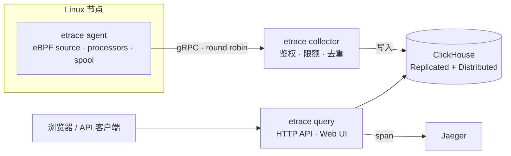

<h1 align="center">eTrace</h1>

<p align="center">
  <strong>看清线程到底在等什么。</strong><br>
  Linux 上的 off-CPU 唤醒链、CUDA/NCCL 等待与 OpenTelemetry span 归属。
</p>

<p align="center">
  <a href="https://github.com/rainyZhou2/eBPFTrace/actions/workflows/ci.yml"></a>
  <a href="../LICENSE"></a>
  
  
  
  
  
  
</p>

<p align="center">
  <a href="#快速开始">快速开始</a> ·
  <a href="#工作原理">工作原理</a> ·
  <a href="#架构">架构</a> ·
  <a href="#集群部署">集群部署</a> ·
  <a href="../README.md">English</a>
</p>

**eTrace 是 Linux 上的 eBPF 等待时间分析器。** 它记录线程在哪里离开 CPU 阻塞、是哪个唤醒者结束了等待，以及 CUDA 线程在哪里等待 GPU。等待时间会归属到阻塞线程当时活跃的 OpenTelemetry span，因此一个慢请求或一个训练 step 可以一路追溯到拖住它的锁、I/O 或 GPU kernel。eTrace 可以直接附加到已经运行的进程，profiler 本身无需重启或重新编译；span 归属额外使用一个很小的 `libetrace_ctx` SDK（见[应用接入](#应用接入)）。

线程被唤醒时，eTrace 会重建唤醒背后的链路：

```text
api  futex_wait
 └─ woken by refresher  unlock
     └─ waiting in do_nanosleep
         └─ woken by [hardirq]  hrtimer_wakeup
```

<p align="center">
  <sub><b>状态：1.0 之前。</b>单元测试覆盖 amd64/arm64；ClickHouse 与 e2e 链路已在 CI 中运行，BPF 内核测试在 QEMU 中覆盖 Linux 5.15 与 6.8。部署前请先阅读<a href="#项目状态与已知限制">项目状态与已知限制</a>。</sub>
</p>

## 目录

- [为什么选择 eTrace](#为什么选择-etrace)
- [快速开始](#快速开始)
- [环境要求](#环境要求)
- [构建](#构建)
- [工作原理](#工作原理)
- [架构](#架构)
- [单机诊断](#单机诊断)
- [集群部署](#集群部署)
- [应用接入](#应用接入)
- [查询数据](#查询数据)
- [开发](#开发)
- [项目状态与已知限制](#项目状态与已知限制)
- [参与贡献](#参与贡献)
- [安全](#安全)
- [致谢](#致谢)
- [许可证](#许可证)

## 为什么选择 eTrace

- **不只给栈，还给唤醒链。** 每次 off-CPU 等待都会记录唤醒者、唤醒者当时在等什么，最多回溯 4 跳，全部在内核的 `sched_waking` 上下文中构建。硬中断、软中断和 idle 唤醒会作为链路终点。
- **GPU 等待不一定离开 CPU。** CUDA 默认调度下，等待 GPU 的线程可能在 CPU 上自旋，调度事件看不到它。eTrace 用 uprobe 给会阻塞宿主的 CUDA/NCCL 调用计时，并记录 stream 以及排在前面的 kernel。
- **Span 归属。** 应用发布当前 span 后，等待时间会汇总到该 span 及其祖先。查询服务会与 Jaeger trace 做关联。
- **单机或集群。** `etrace doctor` 不需要任何后端，直接生成自包含的 HTML 报告；agent、collector 和 query 可以以 Kubernetes + ClickHouse 的方式部署。
- **开放输出。** 火焰图可导出为 pprof 与 collapsed stacks，agent 也可以直接推送到 Grafana Pyroscope。

## 快速开始

### 诊断单台主机

先构建二进制（见[构建](#构建)），把 `bin/etrace-linux-<arch>` 复制到目标主机，以 root 运行：

```sh
sudo etrace doctor                          # 所有进程，录制 30s，生成 etrace-report.html
sudo etrace doctor -pid 1234 -duration 1m
sudo etrace doctor -comm nginx -slow 50ms -o /tmp/nginx.html
```

文本摘要输出到 stdout，HTML 报告写到 `-o`。报告包含录制结束时仍阻塞的线程（挂起候选）、按进程的等待时间、按唤醒链归并的 Top causes、最慢的单次等待，以及交互式火焰图。全部参数见[单机诊断](#单机诊断)。

### 本地跑通完整链路

```sh
make builder   # 只需执行一次
make e2e
```

`make e2e` 用 Docker Compose（`test/e2e/stack`）启动 agent、collector、query、ClickHouse、Jaeger 和一个已接入的 Python 服务。它会验证两条 `load_cache` trace，分别覆盖收到信号后释放锁的真实交接，以及信号虽唤醒持锁线程、锁仍按独立截止时间释放的场景。若要保留环境，先执行 `make build scenarios e2e-scenario`，再到 `test/e2e/stack` 下执行 `docker compose up -d --build`。Web UI 在 http://127.0.0.1:18080（HTTP Basic `e2e`/`e2e`），Jaeger 在 http://127.0.0.1:16686。

e2e 需要一台能访问 BPF 的特权 Docker 主机；CI 会在 `ubuntu-24.04` 上运行同一套栈。若 runner 禁止特权容器或 BPF，应改到 self-hosted 主机运行。

## 环境要求

### 目标主机

- Linux 5.8 或更高，且内核开启 BTF（`/sys/kernel/btf/vmlinux`）。
- DWARF 用户栈回溯需要 Linux 5.17 或更高；更老的内核回退到帧指针。
- GPU 等待需要 Linux 5.15 或更高（uprobe attach cookie）；更老的内核不记录 GPU 等待。
- `CAP_BPF`、`CAP_PERFMON`、`CAP_SYS_RESOURCE`，或直接以 root 运行。
- glibc 2.38 或更高（Debian 13、Ubuntu 24.04）。libstdc++ 已静态链接。

### 构建机

- Docker 与 Buildx（Docker Desktop，或安装 `docker-buildx-plugin`）。编译器、BPF 用的 clang 以及全部固定版本依赖都在构建镜像里。
- gRPC 1.80 或更高。构建镜像固定 1.81；Debian 13 的 1.51 等发行版包对 `src/platform` 里的 TLS credentials 代码来说太旧。

## 构建

eTrace 使用 C++20，构建系统为 CMake，依赖通过 vcpkg 固定（`vcpkg.json`）。

```sh
git clone https://github.com/rainyZhou2/eBPFTrace.git
cd eBPFTrace
make builder   # 只需执行一次：工具链、BPF 用的 clang、vcpkg 依赖
make build     # 编译 BPF 对象并生成 bin/etrace-linux-<arch>
make image     # 运行时镜像（debian:trixie-slim）
make fmt       # 格式化 src 与 test（fmt-check 只检查）
```

- BPF 程序按构建机的架构编译并嵌入二进制。amd64 二进制要在 amd64 构建镜像中构建；arm64 同理。
- 构建镜像默认从 `debian:trixie`、`deb.debian.org` 和 `github.com` 拉取。`BASE_IMAGE`、`APT_MIRROR`、`GITHUB_PROXY`、`SOURCEWARE_MIRROR`、`GNU_MIRROR` 可以把这些步骤转到镜像源，例如 `make builder BUILDER_BUILD_ARGS='--build-arg GITHUB_PROXY=https://gh-proxy.com'`；`build/vcpkg-fetch.sh` 也会把后两个用于 vcpkg 下载。
- 支持 sanitizer 构建：`make build CMAKE_FLAGS=-DETRACE_SANITIZE=address,undefined`（或 `thread`）。
- `make bpf-ide-headers` 和 `make ide` 会把 Linux/libbpf 头文件与编译数据库复制出来，供 clangd 使用。

## 工作原理

### 唤醒链

线程 A 被线程 B 唤醒时，eTrace 检查 B 是否刚结束一段与 A 的等待重叠的等待。如果重叠，就把 B 的链追加到 A 的链上。结果类似：`api` 在 `futex_wait` 中等待 ← 被 `refresher` 的 `unlock` 唤醒，而 `refresher` 当时在 `do_nanosleep` 中等待 ← 被 `[hardirq]` 的 `hrtimer_wakeup` 唤醒。

- 链路在内核的 `sched_waking` 中、以唤醒者的上下文构建，不需要事后拼接事件流。
- 硬中断、软中断和 idle 唤醒会记录为终止跳（`[hardirq]`、`[softirq]`、`[idle]`）。
- 最多保留 4 跳（`chain_depth`）。每一跳都携带自己的唤醒栈、等待栈，以及与原始等待重叠的那部分等待时间。
- 该链路是基于时间重叠的相关性推断，不是因果证明；见[项目状态与已知限制](#项目状态与已知限制)。

### GPU 等待

CUDA 驱动默认调度下，等待 GPU 的线程会在 CPU 上自旋，不进入 off-CPU，单靠调度事件会漏掉。eTrace 直接给这些调用计时。

- agent 在 `/proc/<pid>/maps` 中查找 `libcuda.so`、`libcudart.so`、`libnccl.so`（`gpu.library_patterns`，按 `gpu.scan_interval` 重新扫描），并给会阻塞宿主的调用挂 uprobe/uretprobe：stream、event、context 同步，同步拷贝，以及会触发同步的 free 和 host 分配。每个导出变体（`_v2`、`_ptsz`、`_ptds`）都会覆盖。已在运行的进程无需重启。
- 一次等待是调用进入到返回之间的时间；只有不短于 `gpu.min_wait` 才会记录，并带上调用点的用户栈和 span。cudart 调用 libcuda 时只计外层调用。
- 如果线程在调用内睡眠（`cudaDeviceScheduleBlockingSync`），这段 off-CPU 时间会折叠进 GPU 等待，不会重复计数，同时把这次睡眠的唤醒链附加上去。来自 NVIDIA 驱动中断处理器的唤醒会显示为 `[gpu]` 跳。
- Launch tracking（`gpu.launches`，默认开启）还会探测 kernel 与 graph 启动（`cuLaunchKernel`、`cuLaunchKernelEx`、`cudaLaunchKernel`、`cudaLaunchKernelExC`、`cuGraphLaunch`、`cudaGraphLaunch`）、event record 以及 `cuModuleGetFunction`/`cuLibraryGetKernel`。runtime 启动内部对 driver 的调用不会被重复计数，包括 `cudaGraphLaunch` 调用 `cuGraphLaunch`。它按 stream 和进程记住最后入队的 kernel，并把 event 映射到记录它的 stream。
- 通过 runtime 启动的 kernel 用 host stub 符号化，stub 携带 kernel 的（mangled）名字；通过 driver 启动的 kernel 用返回 handle 的 module lookup 命名，因此在 agent 附加之前拿到的 handle 会显示为 ``[gpu kernel]`[unknown]``。graph 启动显示为 `CUDA graph`。
- launch 探针会在每次启动时触发。如果扫描周期内全机 launch 速率超过 `gpu.max_launch_rate`（默认 20000/s），探针会被永久摘除；等待仍会计时，但不再带 kernel 名。状态通过 `etrace_offcpu_gpu_launch_tracking` 导出。
- 等待用合成的内层栈帧命名：`[gpu]` 加 CUDA 调用，然后是 ``[gpu kernel]`<name>``；如果进程在上一次 GPU 等待之后、本次等待之前发起了 NCCL 集合通信，还会加上 ``[gpu]`waiting on ncclAllReduce``，表示线程在等网络和其他 rank。
- 这些等待的 reason 是 `gpu`，会出现在与 off-CPU 相同的火焰图、causes、events 和 span 视图中。事件还携带 `gpu_stream` 和 `gpu_launches`，即该 stream 自上一次等待以来排队的 kernel。

### Trace 关联

应用通过 `libetrace_ctx` 按线程发布当前 trace/span ID（见[应用接入](#应用接入)）。库把 ID 写入一个由序列计数器保护的线程局部记录；agent 在 `etrace_register_tls` 上挂 uprobe，学会每个线程的记录地址，并在阻塞时用 `bpf_probe_read_user` 读取。

- 带 trace 上下文的等待会作为独立事件发出；没有上下文的等待会聚合，以减小样本体积。
- 查询服务从 Jaeger（或其他 Jaeger 兼容 API）获取 span，把事件分配到对应 span、裁剪到 span 区间，并逐级汇总到祖先 span。

### 用户栈与符号

- 用户栈在 BPF 中基于每个映射对象的 `.eh_frame` 调用帧信息回溯，因此没有帧指针的二进制也能保留调用者。`.eh_frame` 在 `strip` 后仍然存在。没有回溯表的对象（如 JIT 代码或 Go 二进制）回退到帧指针。
- agent 按 build ID 只解析每个对象一次，把行加载进共享 BPF 数组（`unwind.max_rows`，每行 16 字节）。碰到未知进程或地址时，内核侧会让 agent 重新读取 `/proc/<pid>/maps`；单个进程最多每 10s 重载一次。`exec` 会在内核中丢弃该进程的条目。
- `unwind.mode: auto` 会在内核接受时（Linux 5.17+）使用该 walker，否则加载帧指针程序。选择会写日志，并通过 `etrace_offcpu_user_unwinder{mode}` 导出。表使用情况通过 `etrace_unwind_*` 导出。
- 符号化优先使用 `.symtab`。对于 stripped 对象，会按 GNU build ID 在进程根下的 `/usr/lib/debug/.build-id` 查找调试文件，也可以选择从 debuginfod 下载（`symbolize.debuginfod.urls`，默认关闭，因为会把 build ID 发给服务器）。下载在后台进行，写入有界磁盘缓存并按 build ID 校验；下载完成前只解析导出符号。

### 开销

`sched_switch` 和 `sched_waking` 钩子会同步采集内核栈和用户栈，其中 DWARF 用户栈回溯是主要开销。`unwind.mode: frame_pointer` 可以降低这部分成本；`min_block` 只过滤输出中的短等待，**不会降低采集开销**。目前还没有公开的开销基准数据；在全机部署前请先在自己的负载上测量。

## 架构



所有组件共用一个二进制：`etrace agent | collector | query | doctor | version`。

- **agent** 运行在每个节点上。它加载 eBPF source，执行 processor 链（容器元数据、符号化），并把 batch 发往 collector。
- **collector** 用 token 鉴权 agent、执行 batch 限额、去重，并写入存储。
- **query** 提供 HTTP API 与 Web UI，从 ClickHouse 读取数据，并从 Jaeger 获取 span。

| 关注点 | 机制 |
|---|---|
| Collector 故障 | agent 通过 headless Service 解析所有副本，按 round robin 负载均衡，并跳过健康检查失败的副本。存储不可达时，collector 会把自身标记为 NOT_SERVING。 |
| 投递 | batch 先写入磁盘 spool，collector 接受后才确认。重试使用带 jitter 的指数退避。 |
| 重试重复 | 每个 batch 有唯一 ID。collector 用最近 ID 的 LRU 去重，ClickHouse 侧再用 `insert_deduplication_token` 跨副本去重。 |
| 背压 | spool 有字节预算，超出时先淘汰最旧的 batch。BPF map 溢出计入 `etrace_offcpu_bpf_drops`。 |
| 扩展 | collector 与 query 无状态，可水平扩展（HPA、PDB、zone 打散）；存储随 ClickHouse 分片与副本扩展。 |

## 单机诊断

`etrace doctor` 录制一台主机一段时间并输出报告，不需要 collector、ClickHouse 或 query 服务。

- 先检查内核版本、BTF 和权限；如果探针无法运行，会带着原因停止。录制期间发现的降级（帧指针回退、BPF map 占满）会列在结果里。
- 报告包含录制结束时仍阻塞的线程（挂起候选，不计入总量；仍在 GPU 等待中的线程即使自旋也会列出它等待的 kernel）、按进程的 off-CPU 与 GPU 等待时间、按唤醒链归并的 Top causes、最慢的单次等待，以及交互式火焰图。HTML 文件自包含。
- Ctrl-C 会提前结束录制，但仍会生成报告。eTrace 自己的线程会被排除。
- 录制开始前就已经在等待的事件不会被看到；在第一次采集（每秒一次）之前退出的进程，其栈帧不会被符号化。

| 参数 | 默认值 | 含义 |
|---|---|---|
| `-duration` | `30s` | 录制时长 |
| `-pid` | 全部 | 只录制该进程 |
| `-comm` | 全部 | 只报告该命令名的线程 |
| `-min-block` | `1ms` | 忽略更短的等待 |
| `-slow` | `20ms` | 列出达到该时长的单次等待 |
| `-depth` | `4` | 保留的唤醒链跳数（0-4） |
| `-unwind` | `auto` | 用户栈回溯方式：`auto`、`dwarf`、`frame_pointer` |
| `-top` | `20` | 每张表的行数 |
| `-o` | `etrace-report.html` | HTML 报告路径，`""` 表示不写 |
| `-pprof` | 无 | 额外写出 pprof 格式的 profile |
| `-debuginfod` | 无 | 逗号分隔的 debuginfod URL，用于 stripped 二进制（会发送 build ID） |
| `-proc` | `/proc` | procfs 挂载点 |
| `-v` | 关闭 | 输出 agent 内部日志 |

## 集群部署

### Kubernetes

`deploy/k8s` 包含 namespace、agent DaemonSet，以及 collector 和 query 的 Deployment、Service、PDB 和 HPA。清单假定已有 ClickHouse（`clickhouse.etrace.svc:9000`）和 Jaeger query（`http://jaeger-query.observability.svc:16686`）；按实际集群修改 `env`。

```sh
make image                                   # 运行时镜像 etrace:<version> 和 etrace:latest
kubectl apply -f deploy/k8s/namespace.yaml
kubectl -n etrace create secret generic etrace-secrets \
  --from-literal=ingest-token="$(openssl rand -hex 32)" \
  --from-literal=query-token="$(openssl rand -hex 32)" \
  --from-literal=query-user=etrace \
  --from-literal=query-password="$(openssl rand -hex 16)" \
  --from-literal=clickhouse-user=default \
  --from-literal=clickhouse-password='<clickhouse-password>'
kubectl apply -f deploy/k8s/
```

collector 在未配置 token 时拒绝启动；agent 在明文通道发送 token 时，必须显式设置 `allow_insecure: true`。query 的 `/api/*` 需要 bearer token 或 HTTP Basic；配置了 `query-user` 和 `query-password` 时，浏览器 UI 会弹出 Basic 登录框。

collector 启动时会创建 ClickHouse 表（`auto_migrate: true`）；query 不会。把 `CLICKHOUSE_CLUSTER` 设为集群名可创建 replicated 与 distributed 表。

### 配置

每个服务默认读取 `/etc/etrace/<command>.yaml`，可用 `-config path` 覆盖。`${VAR}` 会在 YAML 解析后从环境变量展开；必需值用 `${VAR:?message}`。参考配置在 `configs/`：

| 文件 | 用途 |
|---|---|
| `configs/agent.yaml` | agent：source、processor、exporter、spool、retry |
| `configs/collector.yaml` | collector：token、dedup、batch 限额、ClickHouse 存储 |
| `configs/query.yaml` | query：HTTP 监听、限额、存储、trace 后端 |
| `configs/standalone-collector.yaml` | 使用内存存储的 collector，供本地测试 |

### 运维

每个服务都有管理端口（agent `:9431`、collector `:9432`、query `:9433`），提供 `/metrics`（Prometheus）、`/healthz` 和 `/readyz`。

## 应用接入

Span 关联需要应用发布当前 span。没有接入时，eTrace 仍会记录 off-CPU 时间、唤醒链和栈，只是不会关联到 span。

### C 及其他原生语言

从 `sdk/c` 构建并安装 `libetrace_ctx`：

```sh
make -C sdk/c && sudo make -C sdk/c install   # 默认安装到 /usr/local
```

链接该库，并在 span 成为当前 span 或不再是当前 span 时调用 `etrace_ctx.h` 中的函数：

```c
void etrace_set_context(const uint8_t trace_id[16], const uint8_t span_id[8]);
void etrace_clear_context(void);
```

这两个函数可以在任意线程调用，且不会阻塞。agent 通过 `trace_context.library_patterns` 找到该库，并附加到 `etrace_register_tls`，应用不应直接调用这个内部符号。

### Python

`sdk/python`（`etrace-otel`，Python 3.9+）安装一个 OpenTelemetry runtime context，在每次 attach/detach 时发布当前 span。它会通过动态链接器或 `ETRACE_CTX_LIBRARY` 加载 `libetrace_ctx`。

```sh
pip install ./sdk/python
export OTEL_PYTHON_CONTEXT=etrace_contextvars_context
```

也可以在创建任何 span 之前调用 `etrace_otel.install()`。

## 查询数据

### Web UI

query 服务在 HTTP 端口的 `/` 提供浏览器 UI：过滤器（时间范围、node、namespace、pod、comm、pid、跳数）、带搜索和 pprof/collapsed 下载的交互式火焰图、causes 表、带栈和唤醒链的 events，以及按 trace 的 span 视图。页面是嵌入二进制的静态资源，只调用下面的 API，并带严格的 Content-Security-Policy。

### HTTP API

所有 endpoint 接受同一组过滤器：`from`、`to`、`node`、`comm`、`pid`、`container_id`、`namespace`、`pod` 和 `label=k=v`。

| Endpoint | 返回 |
|---|---|
| `GET /api/v1/offcpu/flamegraph` | 火焰图：JSON、collapsed stacks（`format=collapsed`）或 gzip pprof（`format=pprof`）；`depth=0..4` |
| `GET /api/v1/offcpu/causes` | 按任务路径归并的阻塞时间，以及每条路径的相关位置和证据类型 |
| `GET /api/v1/offcpu/events` | 单次等待，含栈、唤醒链和 trace ID；支持 `trace_id`、`span_id`、`min_duration`、`limit` |
| `GET /api/v1/traces/{trace_id}/offcpu` | 每个 span 的 `offcpu_ns`（含后代）和 `self_offcpu_ns`、背后的事件与 causes |

- `namespace` 和 `pod` 来自 agent 的 `container` processor：pod UID 从任务 cgroup 读取，pod 名、namespace 和容器名从宿主上的容器运行时状态（containerd/CRI-O OCI 配置、Docker labels）读取，入口是 `/proc/1/root`。不需要访问 Kubernetes API，因此拿不到 pod labels。
- `flamegraph`：每一跳以 `--` 帧叠在下面，先是 `<- comm`，然后是它的唤醒栈，再是 `waiting: comm` 和它的等待栈。pprof profile 的 sample type 为 `off_cpu/nanoseconds` 与 `waits/count`，可用于 `go tool pprof`、speedscope 或 Pyroscope；`etrace doctor -pprof file` 也会写一份。
- 单次等待的直接唤醒标为 `wake_evidence: observed`，按重叠关联的上游跳标为 `wake_evidence: inferred`。`wait_evidence: inferred` 表示唤醒者的上一段等待与本次等待存在推断关联。causes 响应沿用 `root_cause` 作为位置字段，并通过 `cause_evidence` 标明阻塞点、观测到的唤醒或推断的上游等待。
- 没有 trace 后端时，trace 事件会以未归属形式返回，`partial` 字段说明原因。
- API 请求按客户端限流（`rate_limit`）。ClickHouse 查询会带上 `storage.options` 里的 `max_execution_time`、`max_memory_usage` 和 `max_rows_to_group_by`；超过预算的查询直接失败，而不是拖垮副本。

### 导出到 Pyroscope

agent 可以用 `exporter.driver: pyroscope`（`url`、`service_name`，可选 `tenant_id` 和 basic auth）直接推送到 Grafana Pyroscope，而不经过 eTrace collector。每个 batch 一次推送，按任务身份生成 series，label 为 `node`、`comm`、`namespace`、`pod`、`container` 以及 agent 的静态 labels，profile 类型为 `offcpu:off_cpu:nanoseconds`。GPU 等待作为单独的 series 推送到 `gpu:gpu_wait:nanoseconds`，不会累加到 off-CPU profile。推送是至少一次语义：响应丢失后的重试会把同一窗口存两次。OTLP profiles 尚未导出，因为该 signal 仍在开发中。

## 开发

### 测试

```sh
make test            # 单元测试（会先构建 scenario 二进制）
make test-clickhouse # 针对临时 ClickHouse 实例测试驱动
make test-kernel     # 在特权容器和 host PID namespace 中跑 BPF 测试
make e2e             # agent + collector + query + ClickHouse + Jaeger + Python 服务
```

内核测试也可以在 QEMU 中运行，不必把宿主机内核暴露给测试进程：

```sh
make kernel-bin scenarios
test/kernel/qemu/run.sh --kernel-image ubuntu:22.04 --expect 5.15
```

`run.sh` 用发行版内核启动一个 initramfs，其中包含测试二进制、scenario 二进制和静态 busybox；它在 guest 内运行 `etrace_kernel_tests`，遇到 skipped 即失败。5.15 内核没有 `bpf_loop`，因此排除只跑 DWARF 的用例，帧指针路径仍会被测试。

### CI

`.github/workflows/ci.yml` 会执行：

- amd64 与 arm64 的单元测试；
- 针对 ClickHouse 24.8 的存储驱动测试；
- 在 `ubuntu-24.04` 上使用特权 Docker 与 BPF 的完整 e2e 链路；
- Ubuntu 5.15 与 6.8 内核上的 QEMU kernel 测试。默认 2 个 vCPU；runner 暴露 `/dev/kvm` 时自动使用 KVM，托管 runner 回退到 TCG。

发布 workflow（`.github/workflows/release.yml`）会把 `v*` tag 变成带校验和的 `etrace-linux-amd64` / `etrace-linux-arm64` 产物和 GitHub release。

### 发布

```sh
git tag -a v0.1.0 -m v0.1.0
git push origin v0.1.0
```

容器镜像目前仍用 `make image` 在本地构建。

### 目录结构

```
api/proto            通信协议（protobuf、gRPC）
src/main.cpp         单一二进制入口：agent | collector | query | doctor
src/model            各组件共享的领域类型
src/wire             protobuf 与 model 之间的转换
src/agent            流水线、插件契约（plugin.h）、驱动工厂
  source/offcpu      eBPF 程序、libbpf 加载器、uprobe 管理（trace 上下文、GPU 等待）、
                     回溯表管理（unwinder）
  processor/*        容器 ID、符号化
  exporter/*         collector 客户端、Pyroscope
src/collector        接入服务与 gRPC handler
src/query            查询服务、火焰图/pprof 渲染、HTTP API、Web UI
src/storage          存储契约、memory 与 ClickHouse 驱动
src/symbol           ELF 读取、kallsyms、/proc/pid/maps、符号表、build ID、debuginfod
src/unwind           .eh_frame 解析器，产出按地址排序的回溯行
src/tracing          trace 后端契约、Jaeger 驱动
src/doctor           单机诊断：预检、录制会话、报告
src/app              各服务的配置与组装
src/platform         通用基础设施（配置、日志、生命周期、spool、gRPC/HTTP、
                     指标、TLS）
sdk/c                libetrace_ctx：按线程发布 trace 上下文
sdk/python           Python 的 OpenTelemetry 集成
test/unit            单元测试与进程内集成测试（GoogleTest）
test/kernel          需要 root、BTF 和 host PID namespace 的 BPF 测试
  qemu/              在一次性虚拟机里运行它们
test/scenario        内核测试用的已知唤醒链负载
test/e2e/stack       Docker Compose 端到端环境
deploy/k8s           DaemonSet、Deployment、Service、PDB、HPA
configs              参考配置
docs                 中文 README
build                构建与运行 Dockerfile、vcpkg overlay
```

`src` 下每个目录是一个 CMake 库，依赖方向向内：`platform` 不依赖 eTrace 的其他部分，业务代码只依赖接口（`storage::Writer`、`storage::Reader`、`agent::Source`、`agent::Exporter`、`tracing::Backend`）。具体驱动只在工厂函数和 `src/app` 中选择。

### 扩展

数据源、处理器、导出器、存储驱动和 trace 后端都通过配置中的 `driver:` 选择。新增一种时，实现对应接口并在其工厂中加一个分支：`src/agent/plugins.cpp` 中的 `agent::new_source`、`new_processor`、`new_exporter`，`src/storage/drivers.cpp` 中的 `storage::open`，或 `src/tracing/tracing.cpp` 中的 `tracing::open`。驱动选项是用 `decode_fields` 解码的普通结构体，未知字段会被拒绝。

## 项目状态与已知限制

eTrace 仍处于 1.0 之前。当前 CI 覆盖 amd64/arm64 单元测试、ClickHouse 存储驱动测试、完整 e2e 链路，以及 Linux 5.15/6.8 的 QEMU BPF 内核测试。已知缺口：

- **唤醒链是相关性，不是因果证明。** 当唤醒者上一段等待与被唤醒者的等待重叠时才会记录一跳。锁交接、条件变量、epoll 和定时器都可能产生看似合理、但并非真实原因的链。
- **用户栈覆盖依赖 `.eh_frame`。** JIT 代码、Go 二进制、信号帧、alt stack，以及受支持规则之外的 DWARF 表达式会回退到帧指针，或丢失部分帧。
- **GPU kernel 名是尽力而为。** 超过 `gpu.max_launch_rate` 后 launch 探针会被摘除，等待不再带 kernel 名。graph 启动显示为 `CUDA graph`，而不是 graph 内的 kernel。
- **托管 CI 使用 TCG，不是 KVM。** QEMU 任务使用 2 个 vCPU。带有 `/dev/kvm` 的 self-hosted runner 会更快，也更不受时序影响。
- **arm64 内核运行时测试尚未进入 CI。** arm64 的构建和单元测试已覆盖，但 QEMU kernel matrix 目前只有 amd64。
- **还没有公开的开销基准。** 全机部署前请在自己的负载上测量。
- **不导出 OTLP profiles。** 目前支持 pprof、collapsed 和 Pyroscope。

## 参与贡献

欢迎提交 issue 和 pull request。较大的改动请先开 issue 讨论设计。

提交 PR 前请执行：

```sh
make fmt-check
make test
make test-kernel   # 没有特权 Docker 时可用 test/kernel/qemu/run.sh
```

保持改动聚焦；修 bug 时补一个回归测试；说明你验证了什么、还有什么没有验证。

## 安全

- agent 需要 `CAP_BPF`、`CAP_PERFMON`、`CAP_SYS_RESOURCE`（或 root），应当按特权基础设施对待。
- collector 用静态 bearer token 鉴权 agent。未配置 token 时启动失败，除非显式启用 `allow_unauthenticated` 或客户端证书 TLS。agent 与 collector 之间应启用 TLS；参考配置的 `tls.allow_insecure` 只用于可信网络。
- query 的 `/api/*` 需要 bearer token 或 HTTP Basic，也可以用 TLS 客户端证书替代；静态 UI 资源保持公开。请在 `configs/query.yaml` 的 `auth` 中配置，并在服务前终止 TLS。
- 报告漏洞请使用本仓库的 GitHub 私有 security advisory，不要开公开 issue。

## 致谢

eTrace 建立在 libbpf 和 bpftool、ClickHouse、cpp-httplib、Prometheus C++ client、Jaeger 和 GoogleTest 之上。Off-CPU 唤醒链的思路可以追溯到 Brendan Gregg 的 off-CPU 分析与 chain graph，以及 bcc 的 `offwaketime`；eTrace 的工作是把链路在内核中构建，并与 GPU 等待和 OpenTelemetry span 关联起来。

## 许可证

Apache-2.0，见 [LICENSE](../LICENSE)。`src/agent/source/offcpu/bpf/offcpu.bpf.c` 和 `test/scenario` 下的场景程序保留其文件头声明的内核社区双许可 `GPL-2.0 OR BSD-2-Clause`。
